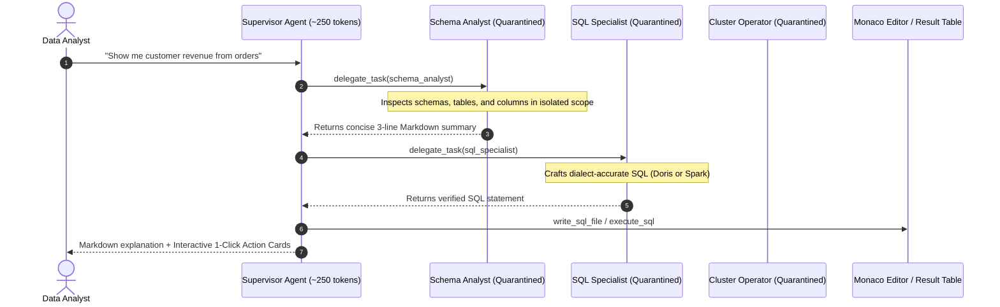
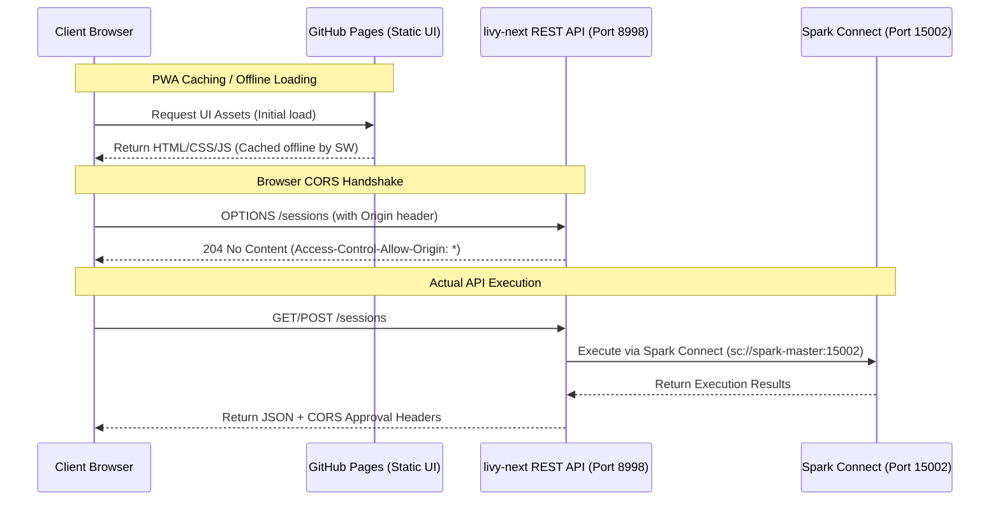

# Livy UI

A modern, high-performance web-based SQL workbench for **Apache Spark SQL** (via [Apache Livy](https://livy.incubator.apache.org/)) and **Apache Doris**, built with React 19, Vite 7, and Monaco Editor. Write, run, and manage analytical queries against remote Spark clusters and Doris data warehouses — completely client-side from your browser.

      

## Features

- **Multi-Provider AI Copilot (`⌘⇧A` / `Ctrl+Shift+A`)** — Autonomous data engineering AI assistant supporting local **Ollama** models (Gemma 2, Llama 3, Qwen 2.5, DeepSeek) with zero telemetry, **Google GenAI** (Gemini 2.5 Flash / Pro), and **OpenAI** (GPT-4o / o1).
- **DeepAgents Subagent Architecture with Context Quarantine** — Supervisor agent delegating to isolated subagents (`schema_analyst`, `sql_specialist`, `cluster_operator`) that run private loops and return distilled summaries, achieving **75%–85% token reduction per turn**.
- **Interactive 1-Click Action Cards** — In-chat action buttons (`[▶ Run Query]`, `[+ Open in Tab]`, `[Insert]`, `[Copy]`) for every generated SQL block with click-protection and tab deduplication.
- **Smart Tab Reuse** — AI edits and query runs default to updating the active editor tab, eliminating tab explosion.
- **Local Workspaces & Native File System Access API (`⌘O`)** — Open local directories and Git repositories directly on disk via `showDirectoryPicker`, with scaffolding templates, nested file tree explorer, and IndexedDB handle persistence.
- **Native Markdown Documents & Live Preview (`⌘⌥M`)** — Full Monaco Markdown editing with Mermaid diagram rendering, KaTeX LaTeX math support, and side-by-side preview.
- **Headless Query Execution** — Execute queries and view live results in the Result Table even when zero files are open on the Welcome Screen.
- **Dual-Engine Architecture (Spark SQL ⇋ Apache Doris)** — Seamless 1-click switching between Apache Spark SQL sessions and Apache Doris MPP data warehouse query execution.
- **Streamlined Compute & Session Manager (`⌘⇧M`)** — Dedicated sidebar panel with isolated engine views (`⚡ Spark` / `🐬 Doris`), real-time latency ping (`● 21ms`), inline database selector, and zero duplicate host cards or badges.
- **Stateless Apache Doris FE Query Execution** — Instant query execution against Doris Frontends (`/api/query/<cluster>/<database>`) with zero startup wait time.
- **Doris Cluster Introspection Tools** — 1-click shortcuts for storage backends, frontend nodes, databases, tables, AI resources, and workload groups with inline `▶ Run` and insert.
- **Engine-Aware Autocomplete & Documentation** — Dynamic Monaco autocompletion for 112+ Doris functions (including native `AI_*` and bitmap operations), 32 data types, 178 keywords, and 13 DDL snippets, plus 600+ Spark SQL functions.
- **Real-Time Static SQL Syntax Validation** — Instant dialect-aware SQL validation powered by `dt-sql-parser` (`MySQL` parser for Doris with syntax masking for custom DDL/SHOW commands; `SparkSQL` parser for Spark).
- **Native Doris AI & LLM Integration** — Built-in templates and query support for Ollama and OpenAI model resources (`AI_TRANSLATE`, `AI_GENERATE`, `AI_SUMMARIZE`, `AI_MASK`).
- **Progressive Web App (PWA)** — Installable web app with service worker asset caching, manifest icons, and offline loopback execution.
- **Connection Health & Reachability** — Real-time server status indicators (`Online`, `Offline`, `Server Down`) with periodic health checks.
- **Compute Resource Manager** — Fine-grained cluster configuration presets (memory, CPU cores, custom Spark submit options).
- **Multi-tab SQL Editor** — Create, rename, and manage multiple SQL files with Monaco Editor.
- **Smart SQL Snippets** — Interactive boilerplate templates for common Spark SQL and Doris operations with tab-stop navigation.
- **Keyboard Shortcuts** — Comprehensive VS Code-style shortcuts for sidebar, result panel, tabs, and query execution.
- **Query Execution** — Run queries against any Livy or Doris server with live elapsed timer, cancellation, and comment-based run history titles.
- **Result Table** — Structured table display with column data types, row counts, execution time, and raw value fidelity.
- **EXPLAIN Plan Viewer** — Syntax-highlighted execution plan display for EXPLAIN queries.
- **Schema Explorer** — Collapsible left sidebar with lazy-loaded tree view of databases, tables, and columns.
- **Session Management** — Start, stop, and monitor Spark sessions with real-time status.
- **Multi-host Support** — Connect to multiple Livy and Doris servers and switch between them seamlessly.
- **Dark Theme** — Modern VS Code dark UI optimized for long coding sessions.
- **LocalStorage Persistence** — All hosts, SQL files, session config, and settings persist across browser reloads.
- **Native CORS Support** — Built-in `livy-next` REST API handles cross-origin requests (`--cors-allowed-origins "*"`) on port 8998 without requiring external proxy containers.

## Tech Stack

| Layer          | Technology                          |
| -------------- | ----------------------------------- |
| Framework      | React 19                            |
| Bundler        | Vite 7.3                            |
| Styling        | Tailwind CSS v4                     |
| Editor         | Monaco Editor (`@monaco-editor/react`) |
| AI Integration | Ollama / Google GenAI / OpenAI SDK  |
| Markdown & Math| Marked + Mermaid 12 + KaTeX         |
| SQL Parsing    | `dt-sql-parser` + `sql-formatter`   |
| HTTP Client    | Axios                               |
| Icons          | Lucide React                        |

## Getting Started

### Prerequisites

- **Node.js** >= 18
- **npm** >= 9
- A running [Apache Livy](https://livy.incubator.apache.org/) server

### Install & Run

```bash
# Clone the repository
git clone <repo-url>
cd livy-ui

# Install dependencies
npm install

# Start dev server
npm run dev
```

Open [http://localhost:5173](http://localhost:5173) in your browser.

### Connect to Livy

1. Click the **Connect** button in the navbar
2. Enter your Livy server URL (e.g., `http://your-livy-host:8998`)
3. Click **Add Host** and select it
4. Start a Spark session using the **Start Session** button

## AI Copilot & DeepAgents Architecture

Livy UI features a built-in AI Copilot (`⌘⇧A` / `Ctrl+Shift+A`) designed specifically for big data analytics and SQL engineering. It supports multiple LLM providers:
- **Ollama** — 100% private local inference on `http://localhost:11434` with zero telemetry (Gemma 2, Llama 3, Qwen 2.5, DeepSeek).
- **Google GenAI (Gemini)** — Gemini 2.5 Flash, Gemini 1.5 Pro, Flash-Lite with 1-click external API key links.
- **OpenAI** — GPT-4o, GPT-4o-mini, and o1 models.

### Context Quarantine with Subagents

Traditional AI assistants suffer from massive token bloat by dumping entire database catalogs, hundreds of columns, and multi-dialect SQL rules into the conversation context. Livy UI solves this using a **Supervisor Agent** with **Quarantined Subagents**:



- **75%–85% Token Reduction**: Subagent loops run in private scopes; only distilled summaries are returned to the supervisor.
- **Sliding Context Window**: The API history payload is capped to the last 8 messages (`messages.slice(-8)`), preventing linear token growth.
- **Interactive 1-Click Action Cards**: Every generated SQL block features inline `[▶ Run Query]`, `[+ Open in Tab]` (with click deduplication protection), `[Insert]`, and `[Copy]` buttons.
- **Smart Tab Reuse**: Queries and AI write operations update the active editor tab by default instead of opening infinite tabs.
- **Headless Execution**: Queries can be executed headlessly from chat or Action Cards even when no file is open, displaying live results directly below the Welcome Screen.

## Local Workspaces & Markdown Documents

Livy UI is not just a scratchpad editor; it is a full local analytical workbench:
- **Local Disk Workspaces (`⌘O`)**: Open local directories and Git repositories directly from your computer using the native File System Access API (`showDirectoryPicker`). Files and edits sync directly to disk. Directory handles persist in IndexedDB across browser reloads.
- **Project Scaffolding**: 1-click workspace scaffolding for `standard`, `spark-sql-workspace`, and `doris-analytics` project templates.
- **Native Markdown Documents (`.md` / `⌘⌥M`)**: Write, edit, and document your analytical runbooks alongside SQL queries. Features live split preview with **Mermaid** diagrams (`graph TD`, `sequenceDiagram`, `classDiagram`) and **KaTeX** LaTeX math formulas (`$...$` and `$$...$$`).

## HDFS & Data Access

This app supports querying data stored on HDFS, S3, or any Spark-compatible file system directly from the SQL editor.

### Querying HDFS Files Directly

Use Spark SQL's **path-based table syntax** to read files without registering them in a catalog:

```sql
-- Parquet files
SELECT * FROM parquet.`hdfs://namenode/path/to/data` LIMIT 100

-- CSV files
SELECT * FROM csv.`hdfs://namenode/path/to/data.csv`

-- JSON files
SELECT * FROM json.`hdfs://namenode/path/to/data.json`

-- ORC files
SELECT * FROM orc.`hdfs://namenode/path/to/data`
```

> **Note:** Path-based tables do not appear in the Schema Explorer since they are not registered in any database catalog.

### Registering Tables for Schema Explorer

To make HDFS data visible in the Schema Explorer sidebar, register it as a named table:

```sql
CREATE TABLE IF NOT EXISTS default.my_table
USING parquet
LOCATION 'hdfs://namenode/path/to/data'
```

After running this, click **Refresh** in the Schema Explorer to see the table, its columns, and data types.

### Schema Explorer

The left sidebar provides a tree view of your Spark SQL catalog:

```
Databases
└── default
    └── my_table
        ├── id (bigint)
        ├── name (string)
        └── created_at (timestamp)
```

- **Lazy loading** — Tables and columns are fetched on expand
- **Copy to clipboard** — Click the copy icon on any node to copy its qualified name
- **Refresh** — Reload the full tree after creating or dropping tables
- **Collapsible** — Toggle the sidebar with the panel icon

### Session Configuration

Pass custom Spark properties when starting a new session via **Settings → Session Configuration**:

| Property | Purpose | Example |
|----------|---------|--------|
| `spark.hadoop.hive.metastore.uris` | Connect to a Hive metastore | `thrift://hive-metastore:9083` |
| `spark.sql.warehouse.dir` | Default storage for managed tables | `hdfs://namenode/user/hive/warehouse` |
| `spark.hadoop.fs.defaultFS` | Default HDFS namenode | `hdfs://namenode:8020` |
| `spark.executor.memory` | Executor memory | `4g` |
| `spark.executor.cores` | Executor cores | `2` |
| `spark.dynamicAllocation.enabled` | Enable dynamic allocation | `true` |
| `spark.sql.shuffle.partitions` | Shuffle partitions | `200` |

Config is persisted in localStorage and sent with every new session creation.

> **Tip:** If your Livy server already runs on a Hadoop cluster with Hive configured, you typically don't need any session config — Spark inherits the cluster's `core-site.xml` and `hive-site.xml` automatically.

### SQL Snippets

The editor includes preloaded interactive templates for common Spark SQL operations. Start typing a snippet prefix (e.g. `create_`) and select it from the autocomplete menu. Once inserted, use **Tab** to jump between placeholders (table names, file paths, options) to fill out your query quickly.

| Snippet | Description |
|---------|-------------|
| `create_table_parquet` | Create a table using Parquet format over HDFS/local storage |
| `create_view_csv` | Mount a CSV file with header and schema inference options |
| `create_view_json` | Create a temporary view from a JSON file |
| `select_limit` | Scaffold a quick `SELECT * FROM ... LIMIT` query |

### EXPLAIN Plan Viewer

Prefix any query with `EXPLAIN` to view Spark's execution plan directly in the result panel with syntax-highlighted operators.

| Statement | What it shows |
|-----------|---------------|
| `EXPLAIN <query>` | Physical plan only (default) |
| `EXPLAIN EXTENDED <query>` | Parsed, Analyzed, Optimized logical plans + Physical plan |
| `EXPLAIN CODEGEN <query>` | Generated Java code for the query |
| `EXPLAIN COST <query>` | Logical plan with cost/statistics info |
| `EXPLAIN FORMATTED <query>` | Physical plan in a more readable, sectioned format |

Example:

```sql
EXPLAIN EXTENDED
SELECT * FROM parquet.`hdfs://namenode/path/to/data` LIMIT 100
```

### Keyboard Shortcuts

| Shortcut (Windows/Linux) | Shortcut (macOS) | Action | Scope |
|--------------------------|------------------|--------|-------|
| `Ctrl+Enter` | `⌘+Enter` | **Run SQL** (selected text or all) | Global / Editor |
| `Ctrl+Shift+A` | `⌘+Shift+A` | **Toggle AI Copilot** | Global / Editor |
| `Ctrl+Shift+M` | `⌘+Shift+M` | **Focus Compute & Session Manager** | Global / Editor |
| `Ctrl+Shift+F` | `⌘+Shift+F` | **Format SQL** (statement-by-statement) | Editor |
| `Ctrl+Shift+U` | `⌘+Shift+U` | **Minify SQL** (statement-by-statement) | Editor |
| `Ctrl+S` | `⌘+S` | **Save file to disk / storage** | Editor |
| `Alt+Z` | `⌥+Z` | **Toggle Word Wrap** (VS Code style) | Editor |
| `Ctrl+B` | `⌘+B` | **Toggle sidebar** | Global / Editor |
| `Ctrl+P` | `⌘+P` | **Search files or run commands** (Command Palette) | Global |
| `Ctrl+,` | `⌘+,` | **Open Settings** | Global |
| `Ctrl+O` | `⌘+O` | **Open Local Folder / Git Repo** | Global |
| `Ctrl+Alt+M` | `⌘+⌥+M` | **New Markdown Document** | Global / Editor |
| `Ctrl+Shift+E` | `⌘+Shift+E` | **Focus File Explorer** | Global / Editor |
| `Ctrl+Shift+K` | `⌘+Shift+K` | **Focus Schema Explorer** | Global / Editor |
| `` Ctrl+` `` | `` ⌘+` `` | **Toggle result panel** | Global / Editor |
| `Ctrl+Alt+N` | `⌘+⌥+N` | **New SQL file** (VS Code-like browser override) | Global / Editor |
| `Ctrl+Alt+W` | `⌘+⌥+W` | **Close active tab** (VS Code-like browser override) | Global / Editor |
| `Ctrl+Shift+T` / `Ctrl+Alt+T` | `⌘+Shift+T` / `⌘+⌥+T` | **Restore last closed tab** | Global / Editor |
| `Ctrl+PageUp` / `Ctrl+Alt+←` | `⌘+PageUp` / `⌘+⌥+←` | **Previous tab** | Global / Editor |
| `Ctrl+PageDown` / `Ctrl+Alt+→` | `⌘+PageDown` / `⌘+⌥+→` | **Next tab** | Global / Editor |
| `Ctrl+H` | `⌘+H` | **Query history** | Global / Editor |
| `Ctrl+.` | `⌘+.` | **Manage compute hosts** | Global / Editor |
| `Ctrl+/` | `⌘+/` | **Show keyboard shortcuts** | Global / Editor |
| `F2` | `F2` | **Rename file** | File Explorer |
| `Del` | `Delete` / `Backspace` | **Delete file** | File Explorer |
| `Esc` | `Esc` | **Close modals / dropdowns** | Global |

## Docker

Pre-built multi-platform container images (`linux/amd64` and `linux/arm64`) are published automatically to the GitHub Container Registry (GHCR).

### Run with Pre-built Image (GHCR)

```bash
# Pull and run the latest image from GitHub Container Registry
docker run -d -p 4173:4173 --name livy-ui ghcr.io/ervijayraghuwanshi/livy-ui:latest
```

Open [http://localhost:4173](http://localhost:4173) in your browser.

### Build & Run Locally

The multi-stage Dockerfile uses Node 22 for fast asset compilation and a lightweight Caddy 2 web server image (~30MB) with gzip/zstd compression and SPA routing:

```bash
# Build the local Docker image
docker build -t livy-ui .

# Run the container
docker run -d -p 4173:4173 --name livy-ui livy-ui
```

### Docker Compose

You can also run Livy UI with Docker Compose:

```bash
# Start Livy UI
docker compose up -d

# Stop Livy UI
docker compose down
```

## Project Structure

```
livy-ui/
├── .github/
│   └── workflows/
│       ├── docker-publish.yml  # Multi-platform image build & push to GHCR
│       └── deploy-gh-pages.yml # Continuous deployment to GitHub Pages
├── Dockerfile                  # Multi-stage production build (Node 22 + Caddy 2)
├── docker-compose.yml          # Production container compose definition
├── index.html                  # HTML entry point
├── package.json
├── vite.config.js              # Vite 7 + Tailwind 4 + PWA Workbox config
├── CHANGELOG.md                 # Version changelog history
├── PRIVACY.md                   # Privacy policy & data handling documentation
├── release-notes/               # Version release notes (v1.1 through v3.1.0)
├── public/                     # Static assets, PWA icons, manifest
└── src/                        # React 19 frontend application source
    ├── main.jsx                # Application root mount
    ├── App.jsx                 # Top-level workspace layout & panels
    ├── index.css               # Tailwind v4 theme & CSS design system
    ├── components/             # Reusable UI components
    │   ├── ActivityBar.jsx     # Primary left icon navigation bar
    │   ├── AiChat/             # AI Copilot UI (Panel, ChatMessage, ModelSelector)
    │   ├── CommandPalette.jsx  # Centered VS Code-style command search (⌘P)
    │   ├── ComputePanel.jsx    # Spark & Doris isolated compute & session manager
    │   ├── ConnectionModal.jsx # Advanced host config, Spark properties & JAR presets
    │   ├── FileExplorer.jsx    # Local workspace disk file tree & templates
    │   ├── MarkdownPreview.jsx # Split-view Markdown preview with Mermaid & KaTeX
    │   ├── ResultTable.jsx     # Query result grid, statistics, and export
    │   ├── SchemaExplorer.jsx  # Database/table/column lazy-loaded catalog tree
    │   ├── SettingsView.jsx    # Multi-category settings overlay (⌘,)
    │   ├── SqlEditor.jsx       # Monaco Editor with engine-aware autocomplete & validation
    │   ├── StatusBar.jsx       # Bottom status bar with engine readiness & diagnostics
    │   ├── TabBar.jsx          # Monaco multi-tab editor header with model swapping
    │   ├── TitleBar.jsx        # Compact window header & quick command center
    │   └── WelcomeScreen.jsx   # VS Code-style welcome screen with quick actions
    ├── context/                # React state providers
    │   ├── AiContext.jsx       # AI Copilot streaming, tool dispatcher & chat history
    │   ├── LivyContext.jsx     # Spark Livy REST sessions, Doris FE hosts & reachability
    │   ├── SchemaContext.jsx   # Catalog metadata cache & background fetcher
    │   ├── SettingsContext.jsx # LocalStorage settings persistence & raw JSON sync
    │   └── SqlFilesContext.jsx # Local file system sync, tabs state & result cache
    ├── services/               # Background services & APIs
    │   ├── ai/                 # AI Copilot agents (agentRunner, subAgentManager, tools)
    │   ├── axiosConfig.js      # Livy API HTTP client
    │   ├── dorisApi.js         # Apache Doris FE HTTP REST query client
    │   ├── fileSystemService.js# File System Access API & IndexedDB handles
    │   ├── livyApi.js          # Apache Livy REST API & statement runner
    │   └── sqlValidator.js     # Dialect-aware SQL syntax parser (dt-sql-parser)
    └── utils/                  # Functions catalog, snippets, helpers
        ├── constants.js        # App constants, defaults, and storage keys
        ├── doris-functions-data.js # 112+ Doris built-in functions
        ├── spark-functions-data.js # 600+ Spark SQL function definitions
        ├── doris-snippets-data.js  # Interactive Doris DDL snippets
        └── spark_sql_snippets.js   # Interactive Spark SQL snippet templates
```

## Architecture & CORS Handling

When connecting a web application to a local or internal Apache Livy server, browsers enforce strict security limits:
1. **Mixed Content Block**: A secure HTTPS site (like GitHub Pages) is not allowed to query an insecure HTTP endpoint (like a local server). This is bypassed by setting Chrome's site settings to **Allow Insecure Content** on the GitHub Pages domain.
2. **CORS (Cross-Origin Resource Sharing)**: Browsers block a web app hosted on one domain (e.g., `https://ervijayraghuwanshi.github.io`) from querying another domain (e.g., `http://localhost:8998` or `http://10.29.93.216:8998`) unless the destination server explicitly returns CORS approval headers.

To resolve these challenges without needing external proxies, the architecture is configured as follows:



### 1. Livy & livy-next Connectivity
Livy UI is a standalone client-side web application designed to connect to any remote or local Apache Livy or `livy-next` server:
- Supports standard Livy REST APIs on port `8998` (or custom host port) with configurable CORS or direct intranet access.
- Submits queries asynchronously, monitors statement execution states, and renders formatted tabular results.
- Works with remote Spark clusters, Databricks/EMR endpoints, or local containerized Spark environments.

### 2. Progressive Web App (PWA) & Offline Capabilities
The UI uses `vite-plugin-pwa` with Workbox to cache all static pages, assets, and the Monaco SQL editor:
- **Offline Mode**: If you disconnect from the internet/Wi-Fi and refresh the page, the application still loads and runs fully offline.
- **Local Loopback Exception**: If you are disconnected from the network, the app recognizes if the target is `localhost` or `127.0.0.1` and bypasses the browser's global offline status check. You can continue running Spark queries against your local container offline.
- **Installable**: The app can be installed directly onto your desktop or mobile home screen as a standalone application.

## Scripts

| Command           | Description                        |
| ----------------- | ---------------------------------- |
| `npm run dev`     | Start dev server (port 5173)       |
| `npm run build`   | Build for production               |
| `npm run preview` | Preview production build (port 4173) |

## License

MIT
