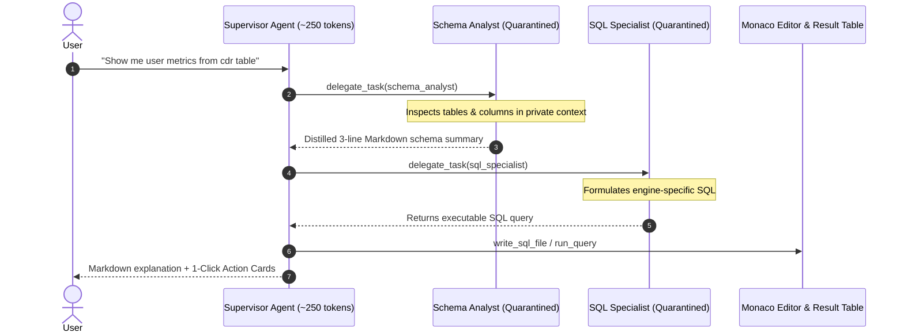

# Release Notes - v3.1.0

**Milestone Release v3.1.0 — AI Copilot with DeepAgents Architecture, Local Workspaces on Disk, Native Markdown Documents, and Streamlined Compute 🚀**

Version 3.1.0 is a major milestone release that elevates Livy UI into an intelligent, end-to-end analytical data platform. It introduces a multi-provider **AI Copilot** powered by autonomous **DeepAgents Subagents** with **Context Quarantine**, native **Local Workspaces** backed by the File System Access API, **Markdown Document Editing** with Mermaid diagrams and KaTeX LaTeX rendering, **Headless Query Execution**, and a streamlined, strictly isolated **Compute & Session Manager**.

---

## 🌟 Major Highlights & What's New

### 1. Multi-Provider AI Copilot (`⌘⇧A` / `Ctrl+Shift+A`)
* **Multi-Provider LLM Integration:**
  - **Ollama**: 100% private, zero-telemetry local inference on your own GPU/CPU (Gemma 2, Llama 3, Qwen 2.5, DeepSeek, etc.).
  - **Google GenAI (Gemini)**: Official Gemini API support (Gemini 2.5 Flash, Gemini 1.5 Pro, Flash-Lite) with 1-click external API key acquisition links.
  - **OpenAI**: GPT-4o, GPT-4o-mini, and o1 models via direct client-side requests using your personal API key.
* **Live Model Metadata & Telemetry:**
  - Dynamic badges displaying parameter size (e.g. `2.6B`), memory footprint (`1.5 GB`), quantization (`Q4_0`), and `Tools Enabled`.
  - Built-in **Warm-Up Detector**: Displays a non-blocking indicator when local Ollama models take >3.5s to load weights into GPU VRAM.

### 2. DeepAgents Multi-Subagent Architecture with Context Quarantine
* **The Token Reduction Solution:**
  - Rather than dumping hundreds of tables, columns, and multi-dialect SQL rules into every conversational turn, Livy UI implements an autonomous supervisor agent with quarantined subagents:
    - 🐬 **Schema Analyst (`schema_analyst`)**: Runs isolated inspection loops using `list_databases`, `search_tables`, and `describe_table` without leaking catalog noise into chat history.
    - ⚡ **SQL Specialist (`sql_specialist`)**: Crafts dialect-accurate SQL queries tailored strictly to the active engine (Apache Spark or Apache Doris).
    - 🖥️ **Cluster Operator (`cluster_operator`)**: Executes queries headlessly, checks session states, and returns concise status summaries.
  - Achieves a **75%–85% token reduction** per turn!
* **Sliding Context Window & Resilience:**
  - API history payload is capped to the last 8 messages (`messages.slice(-8)`), while preserving all 30 messages in the client UI.
  - **1-Click Retry (`[↻ Retry Message]`)**: Automatically recovers from API timeouts or quota limits without requiring users to retype prompts.
  - `localStorage` chat persistence preserves conversations across reloads.



### 3. Interactive 1-Click SQL Action Cards
* **Action Cards Embedded in Chat:**
  - Every SQL block generated by the AI Copilot includes dedicated interactive buttons:
    - `[▶ Run Query]`: Executes query immediately on the cluster and reveals live tabular results.
    - `[+ Open in Tab]`: Opens the query in Monaco editor.
    - `[Insert]`: Pastes the query at the active cursor position.
    - `[Copy]`: Copies the SQL snippet to the clipboard.
* **Duplicate Protection & Tab Deduplication:**
  - Once clicked, `Open in Tab` switches to `<Check /> Opened in Tab` and disables itself to prevent duplicate tab creation.
  - If the query is already open in an existing tab, Livy UI intelligently switches focus to that tab rather than creating duplicates.

### 4. Smart Tab Reuse & Headless Results Execution
* **Intelligent Tab Reuse:**
  - AI write operations and query runs update the active editor tab by default instead of spawning new tabs on every turn.
* **Welcome Screen Headless Execution:**
  - Queries can be executed even when zero files are open in the editor (e.g. on the Welcome Screen).
  - The Result Table and resize sash dynamically render directly beneath the Welcome Screen whenever results are available.

### 5. Local Workspaces & Native File System Access API
* **Direct Disk & Git Repository Access:**
  - Open local directories or Git repositories directly from your computer via `showDirectoryPicker`.
  - Changes persist immediately to disk without uploading files to any external server.
  - Persistent directory handles cached in browser IndexedDB across page reloads.
* **Project Scaffolding Templates:**
  - 1-click scaffolding for `standard`, `spark-sql-workspace`, and `doris-analytics` project structures.
  - Full file tree explorer with folders, nested files, inline renaming, deletion, and file creation.

### 6. Native Markdown Documents (`.md`) with Live Preview
* **Dual Markdown Support:**
  - Create and edit Markdown files alongside SQL files in Monaco Editor.
  - Built-in preview toggle (`⌘⌥M` / split view) with:
    - **Mermaid Diagrams**: Interactive flowcharts, sequence diagrams, and class diagrams.
    - **KaTeX LaTeX Math**: Inline (`$...$`) and display (`$$...$$`) math formulas.
    - **Syntax Highlighted Code Blocks**: Embedded code blocks with copy buttons.

### 7. Streamlined Compute & Engine Isolation
* **Strict Engine Segregation:**
  - When **⚡ Spark** is selected, the Endpoints section displays **only** Spark Livy endpoints (`livy-next`).
  - When **🐬 Doris** is selected, the Endpoints section displays **only** Doris FE clusters (`test`).
  - Completely eliminates cross-engine confusion and accidental host switching.
* **Single-Card Unified Architecture:**
  - Merged active connection parameters directly into the Endpoints section, eliminating redundant duplicate host names, multiple "Attached" badges, and duplicate latency indicators.
* **Doris Quick Tools (1-Click Run & Insert):**
  - Instant access to cluster topology and metadata:
    - `SHOW PROC '/backends';` (Storage Backends)
    - `SHOW PROC '/frontends';` (Frontend Nodes)
    - `SHOW DATABASES;`
    - `SHOW TABLES;`
    - `SHOW RESOURCES;` (AI & LLM models)
    - `SHOW WORKLOAD GROUPS;`
    - `SHOW PROCESSLIST;` (Active queries)

### 8. Modernized Chat Ergonomics & Copy Usability
* **Two-Row Responsive Input Card:**
  - Auto-expanding card container (`min-h-[46px]`, expanding up to 130px) that eliminates text clipping and scrollbar collisions with the Send button.
* **Universal Markdown Code Block Copy:**
  - Every code block rendered from markdown now includes a header showing its language (`SQL`, `PYTHON`, `JSON`) and a 1-click `Copy` button.
* **Full-Message Copy Button:**
  - Copy full AI responses to the clipboard from message headers with 2-second visual feedback (`✓ Copied`).

---

## 🛠️ Upgrading & Compatibility

Livy UI v3.1.0 is 100% backward-compatible with all existing `localStorage` configurations from v3.0.0 and v2.0.0:
- All saved Livy and Doris hosts are preserved automatically.
- Scratchpad tabs and editor history remain intact.
- Docker container images are published to GHCR:
  ```bash
  docker run -d -p 4173:4173 --name livy-ui ghcr.io/ervijayraghuwanshi/livy-ui:latest
  ```
